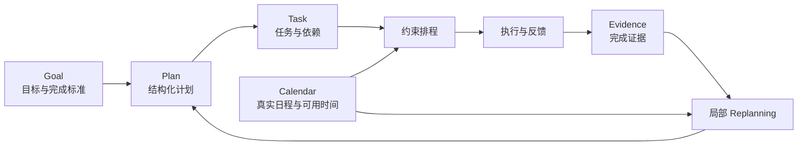
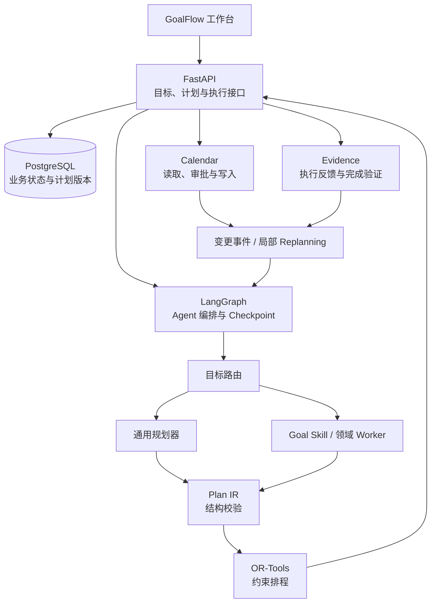

# GoalFlow · 自托管长期目标执行 AI Agent

> 让长期目标在现实变化中继续可执行。

GoalFlow 是一个基于 Docker 自托管的本地优先目标执行工作台。用户创建学习、健身等长期目标后，系统将目标拆解为带有依赖、时间约束和完成标准的任务，结合真实日历协调多个目标的时间冲突。在任务延期、日程变化或阶段结果未达标时，GoalFlow 只调整受影响的部分，持续维护一份能够执行的计划。

项目围绕 **Goal / Plan / Task / Calendar / Evidence** 构建闭环：从目标规划与日历排程，到任务执行、结果验证和局部 Replanning。AI 负责理解目标、拆解任务和提出策略；规则校验与约束求解负责保障时间、依赖和容量等硬约束；重要变更由用户审阅和批准。

## 为什么做 GoalFlow

一次性生成的计划很容易在现实中失效：多个目标争夺同一段时间，突发日程挤占原有安排，任务延期后下游任务仍按旧计划推进，阶段结果不达标却没有触发策略调整。

GoalFlow 将产品定位从一次性的 AI Planning Assistant 收敛为**持续维护可执行计划的长期目标执行工具**。计划既是生成结果，也是后续执行、反馈和调整的基准。每次变化都要明确：哪些任务受到影响、哪些既有安排必须保留、是否需要重新拆解目标。

## 核心对象

| 对象 | 记录什么 | 在闭环中的作用 |
| --- | --- | --- |
| **Goal** | 目标、期限、优先级和完成标准 | 为规划与阶段复盘提供方向。 |
| **Plan** | 阶段安排、计划版本和变更记录 | 保存当前可执行方案及其演进过程。 |
| **Task** | 具体行动、预计耗时、依赖与状态 | 连接规划、日程和实际执行。 |
| **Calendar** | 已有日程与可投入时间 | 约束多个目标对同一时间资源的竞争。 |
| **Evidence** | 任务产出与阶段结果 | 判断任务是否完成、策略是否有效。 |

这些对象共同构成长期状态：日历告诉系统何时能做，任务和依赖决定先做什么，Evidence 告诉系统做完后是否达到了目标。

## 核心工作流

1. **创建目标：** 用自然语言描述目标、期限、可投入时间和完成标准。
2. **生成计划：** 根据目标领域与复杂度选择通用规划器或对应的 Goal Skill，生成任务、依赖关系、阶段节点和完成证据要求。
3. **约束排程：** 将结构化计划转换为 Plan IR，校验后交给 OR-Tools，结合日历空闲时间、截止日期、任务依赖和每日负荷生成可行日程。
4. **审阅并执行：** 展示候选方案与关键取舍，由用户确认重要变更；执行过程中记录任务状态和完成证据。
5. **局部调整：** 任务延期、日历变化或阶段结果未达标时，定位受影响任务，保留已完成、已锁定和无关安排，仅调整必要部分。
6. **复盘迭代：** 将完成结果、历史计划与阶段反馈用于后续规划，使计划随着现实情况持续更新。

**示例：** 用户同时准备一项考试和每周健身。原定周三晚上的复习时间被临时会议占用后，GoalFlow 会检查复习任务的截止日期、后续依赖和其他可用时段，提出局部调整方案；已经完成的任务、用户锁定的健身安排和无关日程保持原样。若阶段测验结果未达标，系统才进一步考虑修改复习任务结构或学习策略。

## AI 与确定性规则的分工

| 环节 | 主要方式 | 原因 |
| --- | --- | --- |
| 理解目标、识别领域与拆解任务 | Agent 与 Goal Skill | 需要处理自然语言、领域知识和多种可行策略。 |
| 统一任务、依赖和时间要求 | Plan IR 与结构校验 | 让不同领域的规划结果进入同一套后续流程。 |
| 检查日历、截止日期、依赖和每日负荷 | 规则校验与 OR-Tools | 硬约束需要确定性的判断与求解。 |
| 处理执行反馈和计划变更 | 事件驱动的局部 Replanning | 只重算受影响范围，降低对既有计划的扰动。 |
| 写入外部日历 | 审批、幂等与结果验证 | 防止重复写入、并发覆盖和未经确认的高风险修改。 |

## 关键设计

### 自适应 Agent 编排与 Goal Skill

GoalFlow 使用 **Adaptive Multi-Agent + Goal Skill** 机制。目标路由先依据领域和复杂度判断任务需求：简单目标由通用规划器处理，需要领域知识时才调用对应 Worker 和 Goal Skill，避免固定运行所有 Agent。

Goal Skill 采用统一协议封装领域规划规则、任务约束与完成标准。学习、健身等领域能力可以复用同一条目标规划、结构校验、排程和执行反馈流程。领域 Worker 提供适合该目标的任务结构与策略，再交由核心约束排程处理。

在多领域目标评测中，路由准确率达到 **94.0%**；相较固定调用全部 Worker，平均模型调用从 **4.1 次降至 2.8 次/计划**。

### Plan IR 与确定性约束排程

Agent 生成的任务、依赖和时间要求先转换为统一的 **Plan IR（计划中间表示）**。Plan IR 将自然语言规划结果变成可校验、可排程、可比较的结构化输入，再编译为 OR-Tools 约束模型。

排程统一处理多个目标对时间资源的竞争，并校验日历冲突、截止日期、任务先后顺序和每日可用容量。LLM 负责目标理解与任务拆解；规则和求解器负责判断计划在现实日程中能否成立。相较 LLM-only 排程，可行计划率从 **76.0% 提升至 96.0%**，正式计划的硬约束违规率保持为 **0**。

### 事件驱动的局部 Replanning

任务延期、日历变化和阶段结果未达标都会转化为计划变更事件。系统沿任务依赖关系定位受影响范围，冻结已完成任务、用户锁定任务和无关安排，然后在受影响区域内重新求解。

时间变化优先直接重新排程；只有任务结构或阶段策略需要改变时，才重新调用对应的 Goal Skill 或 Worker。候选方案会说明调整原因与变化范围，供用户审阅。该机制将 Replanning 成功率从 **77.5% 提升至 92.5%**，平均计划扰动率从 **41.6% 降至 17.9%**。

| 变化类型 | 优先处理方式 | 何时调用领域 Worker |
| --- | --- | --- |
| 日历新增安排或可用时间变化 | 保留任务结构，重新求解受影响任务的时间。 | 通常无需调用。 |
| 任务延期 | 检查下游依赖与截止日期，局部重新排程。 | 延期使原有任务方案失效时调用。 |
| 阶段结果未达标 | 根据 Evidence 评估阶段策略与后续任务。 | 需要重新拆解任务或调整领域策略时调用。 |

### 审批、幂等与异常恢复

对日历等外部操作，GoalFlow 在执行前检查当前状态与计划版本，展示待执行变更并对高风险操作取得用户审批；执行时使用幂等控制，完成后验证结果，避免重试造成重复写入或并发覆盖。故障注入评测的 **100 个测试用例中，重复 Calendar 写入 0 次**。

PostgreSQL 持久化目标、任务、日历关联、完成证据和计划版本；LangGraph Checkpoint 保存 Agent 的长期运行进度。模型超时、服务重启或工具调用失败后，系统保留当前有效计划，并从已保存的安全状态继续执行。

## 技术架构

| 技术 | 用途 |
| --- | --- |
| Python / FastAPI | 业务接口、计划管理和 Agent 工作流服务。 |
| LangGraph | 多步骤 Agent 编排、状态流转与 Checkpoint。 |
| PostgreSQL | 目标、任务、完成证据、计划版本和运行状态持久化。 |
| OR-Tools | 日历、依赖、截止日期和负荷等约束的确定性求解。 |
| Docker Compose | 本地优先的自托管部署。 |

## 评测结果

评测覆盖规划可行性、路由与模型调用、局部调整、响应时延、成本及工具执行可靠性。除计划质量外，也关注现实变化后能否保留用户既有安排，以及外部操作失败时能否安全恢复。

| 指标 | 对照方案 | GoalFlow |
| --- | ---: | ---: |
| 多领域路由准确率 | — | **94.0%** |
| 平均模型调用 | 4.1 次/计划 | **2.8 次/计划** |
| 可行计划率 | 76.0%（LLM-only 排程） | **96.0%** |
| 正式计划硬约束违规率 | — | **0** |
| Replanning 成功率 | 77.5% | **92.5%** |
| 平均计划扰动率 | 41.6% | **17.9%** |
| 重复 Calendar 写入 | — | **0/100 个故障注入用例** |

其中，可行计划率关注排程结果能否满足全部硬约束；计划扰动率关注一次调整对既有安排的影响；工具可靠性通过模型超时、服务重启、重复请求和写入失败等故障情境检查。评测不仅衡量生成质量，也衡量计划能否持续执行，以及变更是否可控。

## 技术栈

**Python · LangGraph · FastAPI · PostgreSQL · OR-Tools · Docker Compose**
