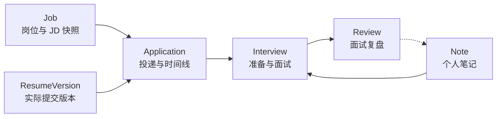
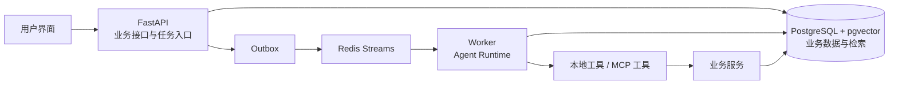

# Career Workbench · 个人智能求职工作台

> 一个以真实投递为中心、支持 Docker 自托管的 AI 求职工作台。

岗位描述保存在浏览器里，简历散落在多个文件中，投递进度记在表格里，面试复盘又留在笔记里。下次准备面试时，求职者往往需要重新拼接这些信息，还可能忘记当时究竟投递了哪一版简历。

本项目以 **Application（一次投递）** 为主线，关联 **Job / Application / Resume / Note / Interview** 五类数据。用户管理真实的岗位、投递和简历版本；Agent 辅助理解岗位、匹配经历、生成可审阅的简历改写建议，并结合实际投递的材料、历史复盘与实时公开面经准备面试。复盘再回到个人资料库，供后续投递使用。

## 特性速览

- **以投递为中心的记录：** 在一条 Application 下查看岗位信息、投递状态、实际提交的简历版本、面试准备和复盘。
- **可追溯的简历版本：** 投递时固定提交版本；后续编辑简历不会改变历史投递的事实。
- **可审阅的 AI 改写：** 先生成结构化 Diff，用户逐项确认，再创建新版本。
- **有业务范围的 Agent：** 先确定当前投递允许使用的资料，再执行检索、生成和工具调用。
- **面向真实面试的准备：** 将本次岗位与提交简历、个人历史复盘和带来源的公开面经结合。
- **自托管与隐私控制：** 业务资料由用户在自己的环境中保存，外部模型和搜索仅接收当前任务所需的最小内容。

## 为什么以 Application 为主线

`Job` 描述岗位，`Resume` 保存可编辑的简历，`Application` 则记录用户对某个岗位发生的**一次真实投递**。渠道、状态、提交时间、提交版本和后续面试都与这次投递有关，因此它是长期求职记录最稳定的连接点。

| 业务对象 | 保存的核心信息 | 在工作流中的作用 |
| --- | --- | --- |
| **Job** | 公司、职位、来源与岗位描述快照 | 为分析、改写和准备提供目标岗位上下文。 |
| **Application** | 投递状态、渠道、时间线与提交版本 | 连接岗位、简历和面试，是业务主线。 |
| **Resume / ResumeVersion** | 结构化简历及不可变的版本快照 | 还原每次实际投递的内容，支持审阅和导出。 |
| **Note** | 用户整理的经历、问题与准备材料 | 作为后续任务可检索的个人资料。 |
| **Interview / Review** | 面试安排、实际问题与复盘 | 记录准备效果，并为下一次面试提供经验。 |

**一个典型例子：** 某次投递使用简历 V8。即使用户后来修改到 V15，这次 Application 仍指向 V8。准备这次面试时，系统首先读取当时的岗位描述和 V8；V15 可以用于新的改写任务，却不能被当成招聘方已经看到的内容。

## 从岗位到复盘

1. **保存岗位：** 记录 JD 原文、来源和岗位信息，保留岗位描述快照。
2. **建立投递：** 创建 Application，管理投递渠道与状态时间线。
3. **分析与改写：** Agent 整理岗位要求、匹配已有经历，并针对指定简历版本提出修改建议。
4. **确认与提交：** 用户审阅 Diff，生成新版本；正式投递时记录实际提交的版本与时间。
5. **准备面试：** 从当前 Application 读取岗位和提交版本，在允许范围内使用历史笔记、复盘及实时公开面经。
6. **记录复盘：** 保存实际问题、回答、薄弱点和有用的准备内容，供下一次任务检索和复用。



岗位录入、投递状态和最终提交版本由明确的业务流程管理；AI 负责需要阅读、语义匹配、归纳或生成的环节。正式向招聘平台投递材料仍由用户自行完成。

## Agent 如何参与工作流

| 任务 | Agent 提供的帮助 | 用户控制点 |
| --- | --- | --- |
| 岗位分析 | 从 JD 提取职责、技能和限制条件。 | 查看原文并修正提取结果。 |
| 经历匹配 | 对照岗位要求与已有经历，指出相关证据和当前材料中的表达缺口。 | 核对匹配依据，不把“未检索到”当成“没有经历”。 |
| 简历定向改写 | 根据目标岗位与真实经历生成结构化修改建议。 | 对每项修改接受、编辑或拒绝。 |
| 面试准备 | 综合提交简历、历史复盘与公开面经，生成准备清单。 | 区分个人事实和外部资料，反馈哪些内容有用。 |

### 简历修改先审阅，再落盘

```text
源简历版本 + 目标岗位
        ↓
AI 生成结构化 Diff（修改位置、前后内容、理由与依据）
        ↓
用户接受 / 编辑 / 拒绝每项建议
        ↓
检查源版本未变化 → 生成新的简历版本
```

Agent 的输出是**提案**，用户的确认指向具体修改和具体版本。若审阅期间简历已被另一次编辑更新，提交会进行版本检查，避免用过期提案覆盖新内容。业务事实和重要写入最终由确定性的业务服务处理。

## 上下文、检索与证据

求职资料越积越多，单纯从全库选择“语义最相近”的片段并不可靠：最新简历可能比旧投递版本更贴近岗位，但面试官当时看到的仍是旧版本。工作台按以下顺序组织 Agent 上下文：

1. **先确定业务范围：** 从当前 Application 直接取得岗位描述快照和实际提交的 ResumeVersion；用户权限、版本与隐私边界先于检索生效。
2. **再检索允许的历史资料：** 对相关 Resume、Note 和 Interview Review 进行语义与关键词混合检索，兼顾同义表达和精确术语；按任务需要融合排序或重排。
3. **将候选内容变成证据：** 为关键结论保留来源类型、资产版本和内容位置，检查岗位要求与个人经历两侧是否都有支持。
4. **在证据不足时调整表达：** 可在允许范围内补充检索；仍找不到时说明“当前提交版本未明确体现”，不推断用户一定没有该能力。
5. **单独处理公开面经：** 实时网页资料标明来源和获取时间，作为本次任务的外部证据；它不会被混写成用户的个人经历或复盘。

这一设计让岗位匹配、简历新增事实和面试建议能够追溯到对应资料，也让模型在证据薄弱或来源冲突时保持谨慎。

## 长任务与工具调用

岗位分析、简历改写和面试准备可能跨越多次检索、模型调用与外部工具调用。工作台将其作为有状态的任务执行：Run、Step 和 Checkpoint 记录进度，PostgreSQL 保存业务与运行状态，Redis Streams 向独立 Worker 分发任务。

- **中断恢复：** Worker 异常后从已保存的步骤继续，浏览器断线不改变任务状态。
- **预算约束：** 限制步骤数、工具调用、检索轮次、时长与费用，避免长任务无限循环。
- **重复执行保护：** 通过版本检查和幂等控制处理重试、重复消息与重复点击。
- **风险分级：** 只读查询可以按权限执行；修改重要业务内容需要展示差异并获得用户批准。
- **工具治理：** 本地工具和 MCP 能力使用统一的调用边界；接入工具并不自动赋予 Agent 写入权限。

## 评测与产品指标

项目建立 **400+ Frozen Eval Case**，覆盖检索与证据、任务恢复、工具调用和端到端工作流。Bad Case 按错误版本引用、证据不足、越权工具调用、重复写入等原因归类，修复后进入回归集合；故障注入检查超时、Worker 中断和重复投递等路径。

固定端到端评测由 **100 个任务各运行 5 次**组成，共 500 次执行。Task Success 从 **368/500（73.6%）** 提升到 **403/500（80.6%）**，按整数约为 **74% → 81%**。成功判定先检查业务范围、关键结论依据、审批和副作用等硬约束，再评价内容的相关性与可用性。

产品效果还从用户是否真正完成任务来衡量，而不只看生成文本是否流畅：

| 维度 | 关注的指标 |
| --- | --- |
| 工作流完成 | 投递建档、简历审阅、面试准备和复盘的完成情况。 |
| 建议采用 | 简历改写的直接接受、编辑后采用和拒绝情况。 |
| 准备价值 | 面试准备内容的相关性、实际问题覆盖和历史复盘复用。 |
| 运行质量 | 无依据生成、错误版本引用、任务恢复、响应时延与单次调用成本。 |

## 技术架构

整体采用**模块化单体 + 独立 Worker**：API、Worker 和业务服务共享领域规则；PostgreSQL 保存业务事实与版本快照，Redis 负责异步任务分发与短期运行支撑。检索索引是可更新的辅助数据，不能代替投递记录和简历版本的业务真值。



| 技术 | 主要用途 |
| --- | --- |
| Python / FastAPI | 业务 API、任务入口与 Agent 工作流。 |
| PostgreSQL | 岗位、投递、简历版本、复盘及运行状态的持久化。 |
| pgvector | 与业务范围结合的语义检索。 |
| Redis | 异步任务分发和运行时支撑。 |
| MCP | 接入外部工具能力，授权与审批仍由本地策略控制。 |
| Docker Compose | 个人环境下的自托管部署。 |

## 隐私边界

**自托管意味着业务数据和应用部署由用户控制，不意味着所有 AI 处理都在本机完成。** 当任务调用外部模型、Embedding 或网页搜索时，相关服务仍会处理被发送的内容。因此工作台先按 Application 限定范围，再只提供完成当前任务必需的片段；公开搜索查询使用公司、岗位和主题等必要信息，不发送完整简历或私人复盘。

个人资料、公开网页和运行日志分别管理：简历与复盘是长期业务资料；实时面经默认只在当前任务中使用；日志主要记录状态、耗时、错误类别与成本，不把完整敏感正文当作常规日志内容。

## 快速开始

准备 Docker 与 Docker Compose。克隆仓库后，将 [环境变量模板](backend/.env.example) 复制为 `backend/.env.dev`，在新文件中填写所需配置并启动服务：

```bash
git clone https://github.com/TianhuaYuan/Career-Workbench.git
cd Career-Workbench
cp backend/.env.example backend/.env.dev
# 编辑 backend/.env.dev，填写所需配置
docker compose up -d --build
```

在 Windows PowerShell 中，可用 `Copy-Item backend/.env.example backend/.env.dev` 代替 `cp`。启动后访问 [http://localhost:8080](http://localhost:8080)；停止服务时执行 `docker compose down`。

## 仓库导航

- [backend/](backend/)：业务服务、Agent 工作流与工具接入。
- [frontend/](frontend/)：求职工作台界面。
- [evals/](evals/)：评测与回归相关内容。
- [docker-compose.yml](docker-compose.yml)：自托管部署配置。

## 参与贡献

欢迎通过 Issue 反馈问题或提出改进建议，也欢迎通过 Pull Request 完善功能、文档和评测用例。描述问题时请附上使用场景、预期结果与实际结果；提交改动时请说明解决的问题和验证方式，避免在公开内容中附带真实简历或面试隐私数据。
