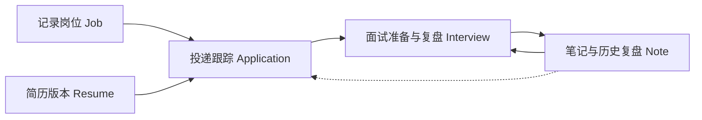

# 个人智能求职工作台

基于 Docker 自托管的个人智能求职工作台，以 **Application（投递）** 为主线，串联 **Job / Application / Resume / Note / Interview** 五类求职数据。工作台将 Agent 能力引入岗位分析、简历定向改写和面试准备，让实际投递的简历版本、历史复盘与实时面经持续服务于下一次求职任务。

从记录岗位到投递、简历优化、面试准备与复盘，求职过程中的信息在同一条业务链路中积累，形成可复用的数据闭环。

## 为什么做这个项目

| 求职中的常见问题 | 工作台的处理方式 |
| --- | --- |
| 岗位信息分散，难以持续跟踪 | 围绕 Job 和 Application 记录岗位与投递过程。 |
| 简历版本混乱，难以确认投递了哪一版 | 将 Application 与实际投递的 Resume 版本关联，并保留修改过程。 |
| 每次准备面试都要重新整理经历和材料 | 结合历史 Note、Interview 复盘与实时面经生成个性化准备内容。 |
| AI 可能引用错版本或生成没有依据的内容 | 按业务关系限定上下文，通过混合检索、证据校验和人工确认降低风险。 |

项目在需求规划中梳理岗位记录、简历优化、投递跟踪与面试复盘等核心用户流程，区分传统业务操作与适合 AI 介入的高价值环节，并结合用户价值、使用频率和实现成本确定优先级。通过对比通用大模型、AI 简历工具、求职管理工具和面试准备类产品，形成以 Application 为业务主线的一体化产品定位。

## 核心业务流程

1. **记录岗位：** 将目标岗位纳入 Job，保留后续分析所需的岗位信息。
2. **分析与匹配：** Agent 分析岗位要求，并匹配候选人的经历与简历内容。
3. **定向改写：** 基于目标岗位生成简历修改建议，用户审阅结构化 Diff 后生成新版本。
4. **记录投递：** 通过 Application 跟踪投递，并关联实际使用的简历版本。
5. **准备面试：** 结合当前岗位、投递简历、历史复盘及实时面经生成个性化准备内容。
6. **沉淀复盘：** 将面试记录与笔记留在业务链路中，为后续投递和准备提供上下文。



## Agent 工作流与交互

Agent 参与岗位分析、经历匹配、简历改写和面试准备。针对多版本简历与长期历史数据，每项任务建立独立的任务级上下文，使生成内容对应当前岗位、当前投递及实际使用的简历版本。

简历改写遵循明确的审阅流程：

```text
AI 生成结构化 Diff  →  用户确认  →  生成新版本
```

重要修改由用户确认后才进入新版本。AI 提供建议和草稿，不直接覆盖真实业务数据。

## 可信度设计与效果评测

多版本数据引用错误、证据不足和模型无依据生成，是求职场景中需要重点处理的问题。工作台先根据 Job、Application、Resume、Note 和 Interview 之间的业务关系缩小上下文范围，再通过混合检索与证据校验，提高结果的准确性和可追溯性。

| 评测与指标 | 内容 |
| --- | --- |
| 固定评测集 | 400+ Frozen Eval Case。 |
| 回归机制 | 持续收集 Bad Case，针对检索、工具调用和模型行为进行回归优化。 |
| 端到端效果 | 固定评测集上的 Task Success 从约 **74%** 提升至 **81%**。 |
| 持续跟踪 | 任务成功率、无依据生成、调用成本和响应时延。 |

## 技术架构

| 领域 | 技术 | 用途 |
| --- | --- | --- |
| 后端服务 | Python、FastAPI | 承载业务接口与 AI 工作流。 |
| 业务数据 | PostgreSQL | 管理岗位、投递、简历、笔记和面试数据。 |
| 语义检索 | pgvector | 支持与任务上下文结合的向量检索。 |
| 缓存与任务支撑 | Redis | 支撑响应效率与长任务处理。 |
| 工具接入 | MCP | 连接 Agent 可调用的外部能力。 |
| 自托管部署 | Docker Compose | 组织工作台所需服务。 |

## 可靠性与隐私

AI 能力从效果、时延、成本、隐私和可靠性五个维度评估。长任务中断、外部工具异常与重复执行通过恢复和预算机制处理；高风险操作进入审批流程。

工作台采用 Self-hosted 部署，并通过最小必要上下文与外部数据隔离降低简历和面试信息的隐私风险。向 Agent 提供的材料以当前任务所需的岗位、投递及简历版本为范围，避免无关历史数据进入生成过程。

## 仓库导航

- [backend/](backend/)：后端服务与 Agent 能力。
- [frontend/](frontend/)：工作台界面。
- [evals/](evals/)：评测相关内容。
- [docker-compose.yml](docker-compose.yml)：自托管部署配置。

## 快速开始

准备 Docker 与 Docker Compose。克隆仓库后，将 [环境变量模板](backend/.env.example) 复制为 `backend/.env.dev`，在新文件中填写所需配置并启动服务：

```bash
git clone https://github.com/TianhuaYuan/ai-resume-analyzer.git
cd ai-resume-analyzer
cp backend/.env.example backend/.env.dev
# 编辑 backend/.env.dev，填写所需配置
docker compose up -d --build
```

在 Windows PowerShell 中，可用 `Copy-Item backend/.env.example backend/.env.dev` 代替 `cp`。

启动后访问 [http://localhost:8080](http://localhost:8080)。停止服务时执行 `docker compose down`。

## 参与贡献

欢迎通过 Issue 反馈使用问题或提出改进建议，也欢迎通过 Pull Request 参与功能、文档和评测用例的完善。提交问题时请说明使用场景、预期结果与实际结果；提交改动时请描述解决的问题及验证方式。
